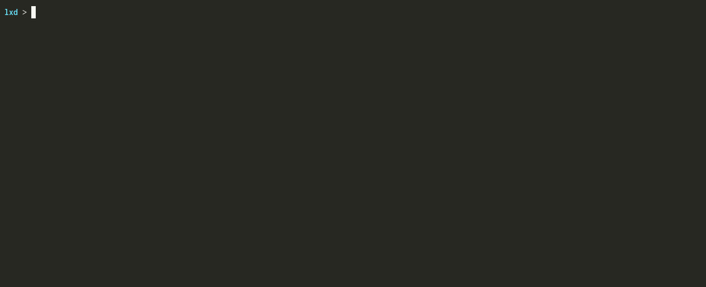
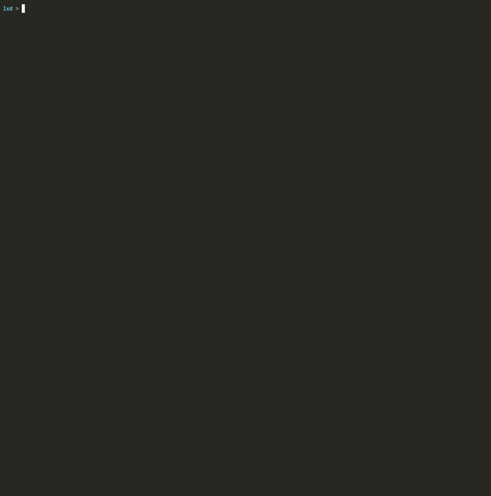
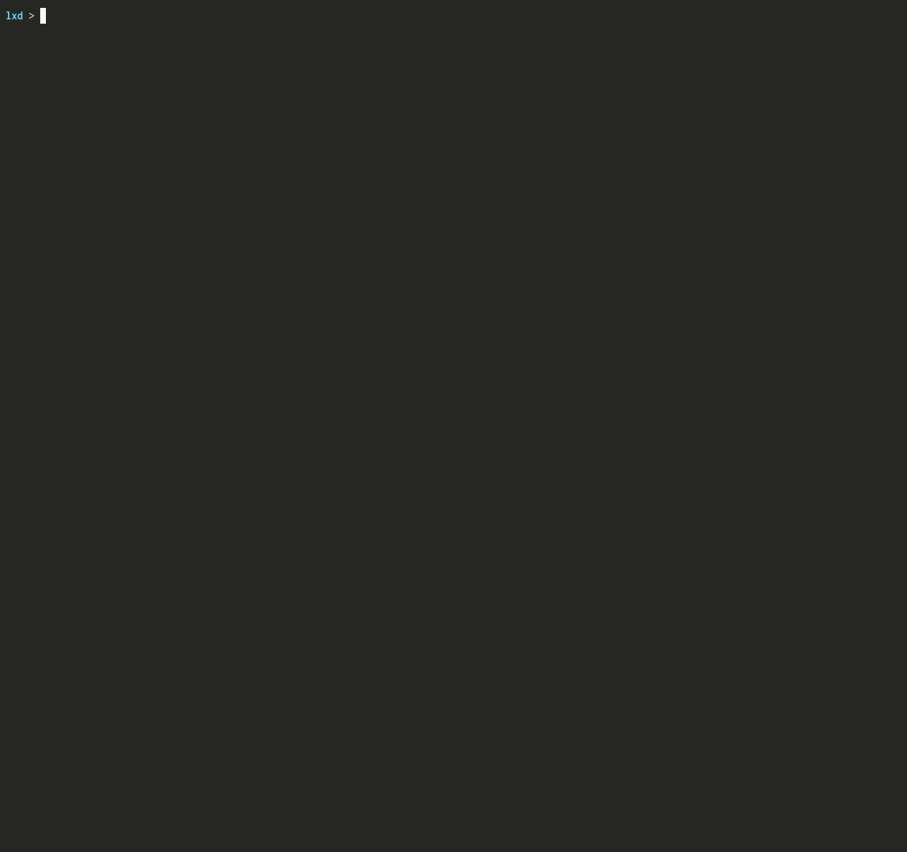

# LXD Profiles

🇫🇷 [Lire en français](README.md)

This repository contains a collection of LXD profiles and network configurations designed to streamline the deployment and management of LXD containers.

## Directory Structure

- `profiles/`: Contains various LXD profile definitions categorized by their purpose (e.g., applications, networking, storage).
- `network/`: Defines LXD network configurations.
- `docs/`: Additional documentation and helper scripts.
- `demo/`: Animated demos of the mise tasks ([how they are made](demo/README.en.md)).
- `mise.toml`, `.mise/`: optional [mise](https://mise.jdx.dev) tasks to manage LXD profiles (`mise.demo.toml`: demo recording tools).

## Demo

### Plain `lxc`, without mise


<sub>▶ [asciinema recording](demo/lxc.cast) (pause, fast forward)</sub>

### Tour of the mise tasks

Welcome message when entering the directory, profile list with their state in
LXD, profile content and diff between LXD and the repository.


<sub>▶ [asciinema recording](demo/tour.cast) (pause, fast forward)</sub>

### Install, update and import a profile

A profile is installed, then changed directly in LXD: installing it again shows
the diff and asks for confirmation; `import` brings the change back into the
repository instead.


<sub>▶ [asciinema recording](demo/install.cast) (pause, fast forward)</sub>

## Tutorials

Step-by-step use cases, from the clone of the repository to a ready instance:

- [Docker in an LXD container](demo/docker/README.en.md): install the
  `docker-unprivileged` profile, launch an instance and use Docker.

## Usage

Profiles can be used with the `lxc` client alone; [mise](https://mise.jdx.dev)
is optional and only adds comfort on top of it.

| Use case | Prerequisites |
|---|---|
| Plain `lxc` | LXD and the `lxc` client |
| With mise | LXD, the `lxc` client and [mise](https://mise.jdx.dev) (it installs `yq`, `gum`, `delta` and `bat` with `mise install`) |

### Plain `lxc`, without mise

Each `*.profile.yaml` file is a regular LXD profile, as printed by
`lxc profile show`: it can be applied as is.

```bash
# Create (or update) a profile from its file
lxc profile create docker
lxc profile edit docker < profiles/containerization/docker.profile.yaml

# Use it when launching an instance
lxc launch ubuntu:24.04 web -p default -p docker

# Compare the installed profile with the repository
# (raw diff: field order, quoting and used_by also show up)
diff <(lxc profile show docker) profiles/containerization/docker.profile.yaml

# Save a profile changed in LXD back into the repository
# (then remove the read-only used_by and project fields)
lxc profile show docker > profiles/containerization/docker.profile.yaml
```

### With mise

The mise tasks wrap the same `lxc` commands and add:

- a short help displayed when entering the directory (mise `enter` hook), and
  `mise tasks` to list every task;
- a profile list showing each one's state in LXD (up to date, different, not
  installed);
- colored diffs (`delta`) computed on a normalized form, so formatting or
  quoting alone never shows up as a change;
- interactivity: profile selection and yes/no confirmation before overwriting
  a profile that differs (`gum`), YAML highlighting (`bat`);
- a clean import of LXD profiles into the repository.

A profile can be designated by its name (`docker`) or its file
(`profiles/containerization/docker.profile.yaml`).

| Task | Description |
|---|---|
| `mise run list [--all]` | Repository profiles and their state in LXD: ✅ up to date, 📝 installed but different, ⬜ not installed. `--all` also shows 🔹 profiles installed in LXD but missing from the repository |
| `mise run show [profile] [--lxd]` | Displays a repository profile (YAML highlighted with `bat`), or with `--lxd` the version installed in LXD |
| `mise run diff [profile...]` | Diff between the installed profile (LXD) and the repository file. Without argument, every installed profile that differs. `--exit-code` returns 1 when there are differences |
| `mise run install [profile...]` | Creates or updates profiles. An existing profile that differs shows its diff and asks for confirmation (`--yes` to skip). Without argument, interactive selection; `--all` for every profile |
| `mise run import [profile] [file]` | Writes an installed LXD profile to the repository (without `used_by`, `project`, empty `config`/`devices`). Defaults to the repository file declaring that name, or `profiles/<profile>.profile.yaml`. Review with `git diff` before committing |

Differences are computed on a normalized form (keys sorted, values as strings,
read-only fields dropped). Top-level keys unknown to LXD (silently ignored by `lxc profile edit`)
are reported, and `install` refuses such files.

```bash
mise run list --all
mise run diff docker
mise run install docker profiles/applications/traefik.profile.yaml
mise run import s3 profiles/applications/s3.profile.yaml && git diff
```
