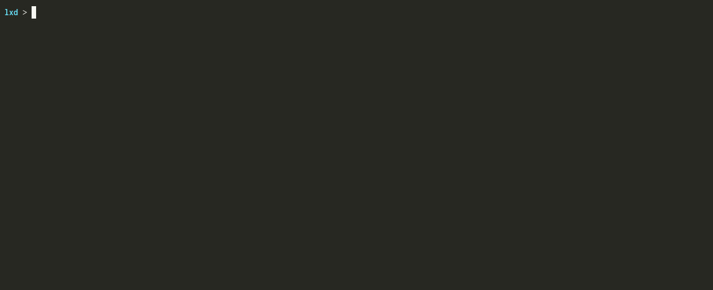
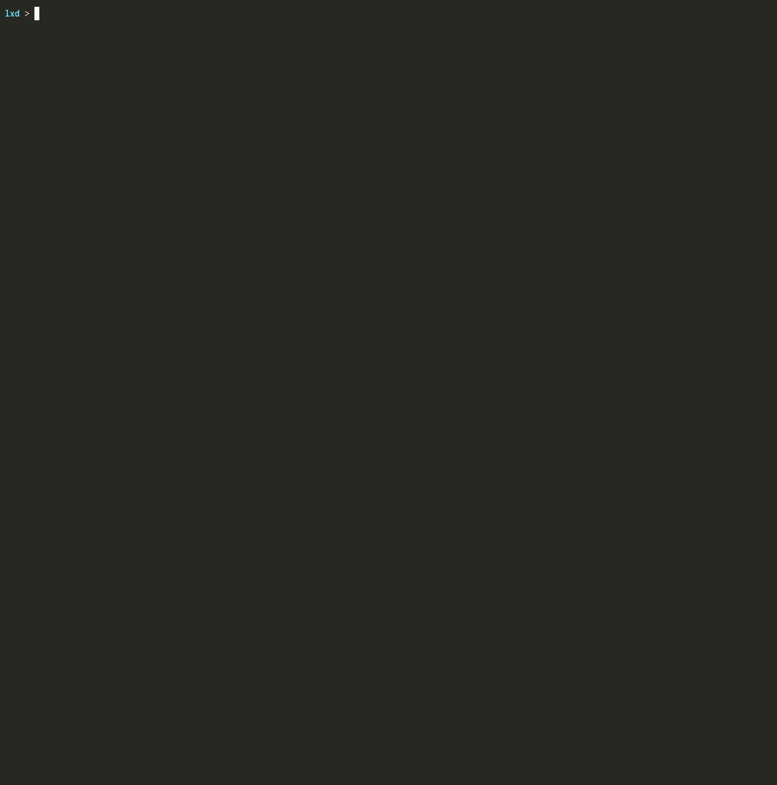
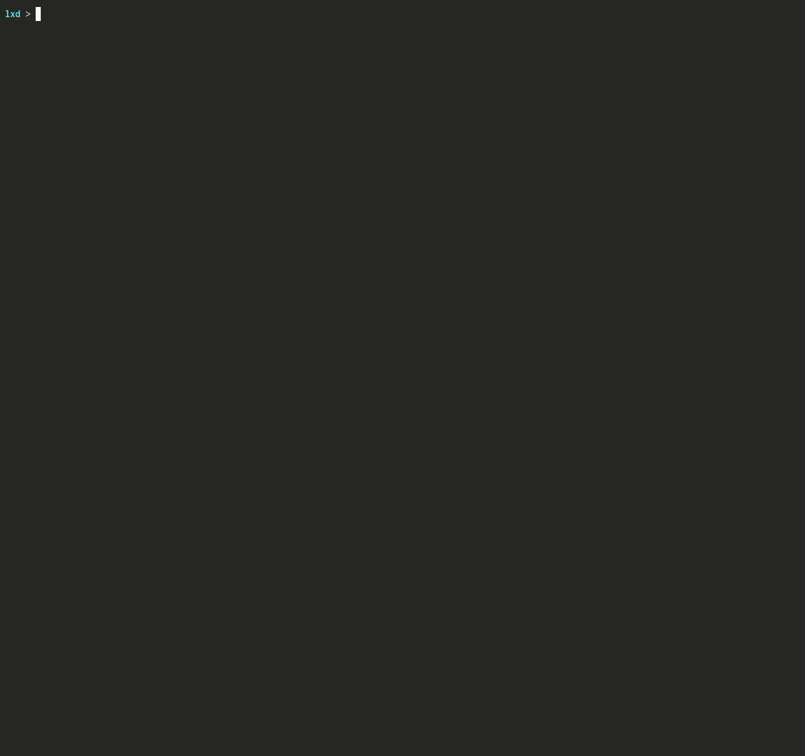

# Profils LXD

🇬🇧 [Read in English](README.en.md)

Ce dépôt rassemble des profils et des configurations réseau LXD, pour simplifier
le déploiement et la gestion de conteneurs LXD.

## Organisation du dépôt

- `profiles/` : les profils LXD, classés par usage (applications, réseau, stockage…).
- `network/` : les configurations réseau LXD.
- `docs/` : documentation complémentaire et scripts d'aide.
- `demo/` : les démos animées ([comment elles sont produites](demo/README.md)).
- `mise.toml`, `.mise/` : tâches [mise](https://mise.jdx.dev), optionnelles, pour gérer les profils LXD (`mise.demo.toml` : outils d'enregistrement des démos).

## Démo

### Avec `lxc` seul, sans mise


<sub>▶ [Enregistrement asciinema](demo/lxc.cast) (pause, avance rapide)</sub>

### Tour des tâches mise

Message d'accueil à l'entrée dans le dossier, liste des profils avec leur état
dans LXD, contenu d'un profil et différences entre LXD et le dépôt.


<sub>▶ [Enregistrement asciinema](demo/tour.cast) (pause, avance rapide)</sub>

### Installer, mettre à jour et importer un profil

Un profil est installé, puis modifié directement dans LXD : le réinstaller
affiche le diff et demande une confirmation ; `import` rapatrie au contraire
la modification dans le dépôt.


<sub>▶ [Enregistrement asciinema](demo/install.cast) (pause, avance rapide)</sub>

## Tutoriels

Des cas d'usage pas à pas, du clone du dépôt à une instance prête à servir :

- [Docker dans un conteneur LXD](demo/docker/README.md) : installer le profil
  `docker-unprivileged`, lancer une instance et utiliser Docker.

## Utilisation

Les profils s'utilisent avec le seul client `lxc` ; [mise](https://mise.jdx.dev)
est optionnel et n'apporte que du confort en plus.

| Cas d'usage | Prérequis |
|---|---|
| `lxc` seul | LXD et le client `lxc` |
| Avec mise | LXD, le client `lxc` et [mise](https://mise.jdx.dev) (qui installe `yq`, `gum`, `delta` et `bat` avec `mise install`) |

### Avec `lxc` seul, sans mise

Chaque fichier `*.profile.yaml` est un profil LXD ordinaire, au format de
`lxc profile show` : il s'applique tel quel.

```bash
# Créer (ou mettre à jour) un profil à partir de son fichier
lxc profile create docker
lxc profile edit docker < profiles/containerization/docker.profile.yaml

# L'utiliser au lancement d'une instance
lxc launch ubuntu:24.04 web -p default -p docker

# Comparer le profil installé avec le dépôt
# (diff brut : l'ordre des champs, les guillemets et used_by apparaissent aussi)
diff <(lxc profile show docker) profiles/containerization/docker.profile.yaml

# Enregistrer dans le dépôt un profil modifié dans LXD
# (puis retirer les champs en lecture seule used_by et project)
lxc profile show docker > profiles/containerization/docker.profile.yaml
```

### Avec mise

Les tâches mise s'appuient sur les mêmes commandes `lxc` et ajoutent :

- une aide courte affichée à l'entrée dans le dossier (hook `enter` de mise),
  et `mise tasks` pour lister toutes les tâches ;
- une liste des profils avec l'état de chacun dans LXD (à jour, différent,
  non installé) ;
- des diff colorés (`delta`), calculés sur une forme normalisée : une simple
  différence de mise en forme ou de guillemets n'apparaît jamais ;
- de l'interactivité : sélection des profils et confirmation oui/non avant
  d'écraser un profil qui diffère (`gum`), coloration du YAML (`bat`) ;
- un import propre des profils LXD dans le dépôt.

Un profil se désigne par son nom (`docker`) ou par son fichier
(`profiles/containerization/docker.profile.yaml`).

| Tâche | Description |
|---|---|
| `mise run list [--all]` | Profils du dépôt et leur état dans LXD : ✅ à jour, 📝 installé mais différent, ⬜ non installé. `--all` affiche aussi 🔹 les profils installés dans LXD mais absents du dépôt |
| `mise run show [profil] [--lxd]` | Affiche un profil du dépôt (YAML coloré par `bat`), ou avec `--lxd` la version installée dans LXD |
| `mise run diff [profil...]` | Diff entre le profil installé (LXD) et le fichier du dépôt. Sans argument, tous les profils installés qui diffèrent. `--exit-code` renvoie 1 s'il y a des différences |
| `mise run install [profil...]` | Crée ou met à jour des profils. Un profil existant qui diffère affiche son diff et demande confirmation (`--yes` pour passer outre). Sans argument, sélection interactive ; `--all` pour tous les profils |
| `mise run import [profil] [fichier]` | Écrit un profil installé dans LXD vers le dépôt (sans `used_by`, `project`, ni `config`/`devices` vides). Par défaut, le fichier du dépôt qui déclare ce nom, sinon `profiles/<profil>.profile.yaml`. À relire avec `git diff` avant de commiter |

Les différences sont calculées sur une forme normalisée (clés triées, valeurs
converties en chaînes, champs en lecture seule écartés). Les clés de premier
niveau inconnues de LXD (ignorées sans avertissement par `lxc profile edit`)
sont signalées, et `install` refuse ces fichiers.

```bash
mise run list --all
mise run diff docker
mise run install docker profiles/applications/traefik.profile.yaml
mise run import s3 profiles/applications/s3.profile.yaml && git diff
```
