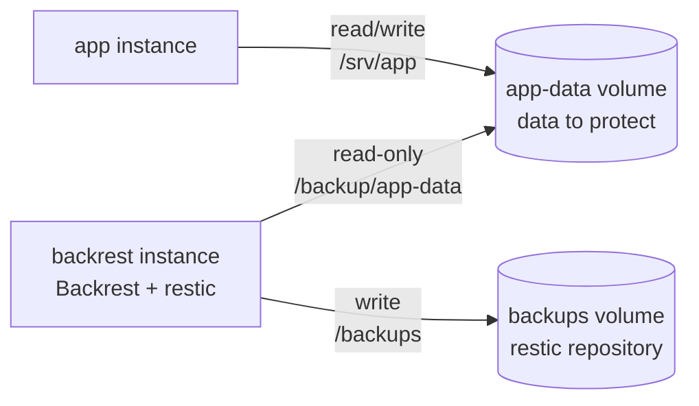
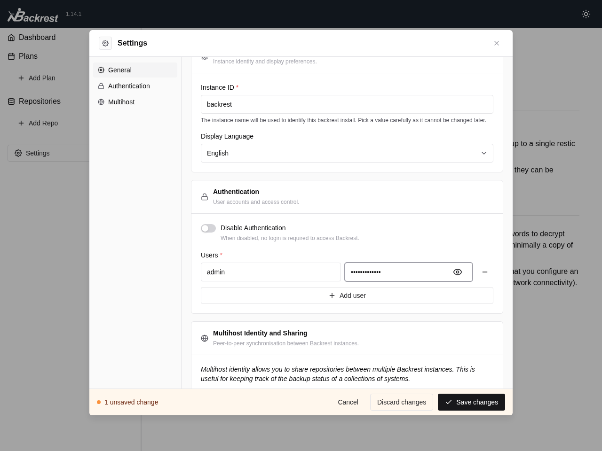
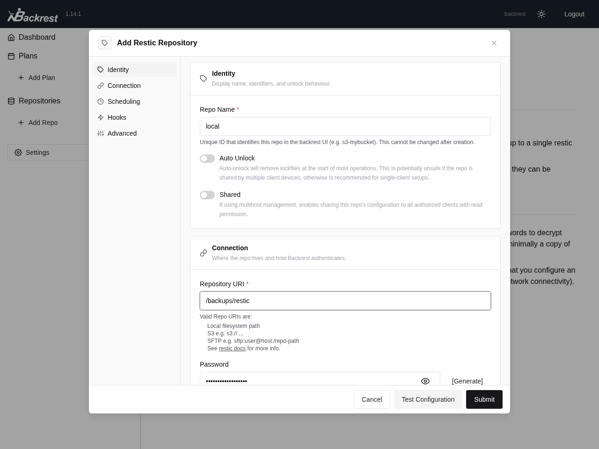
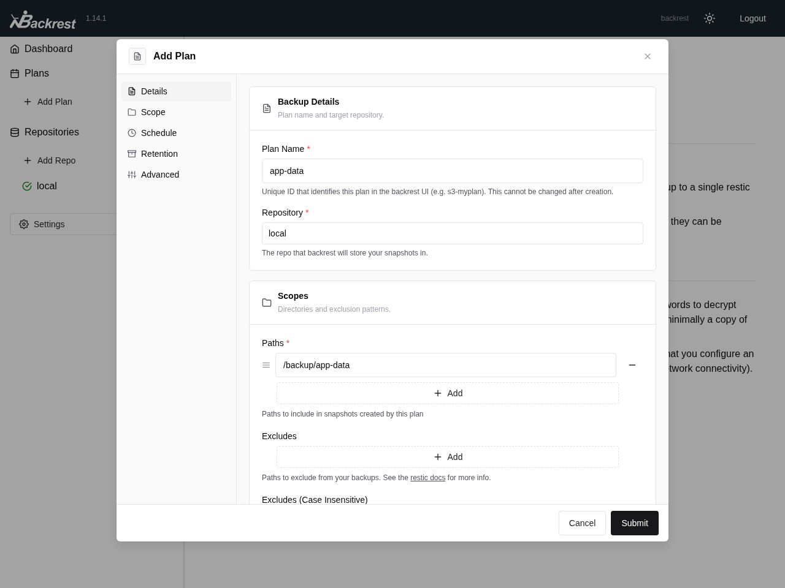
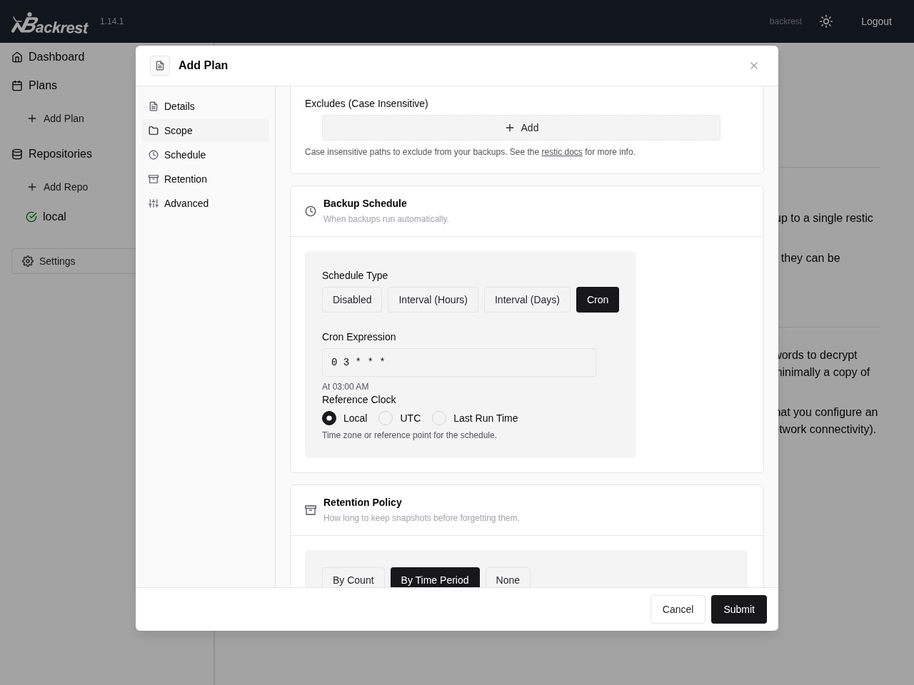
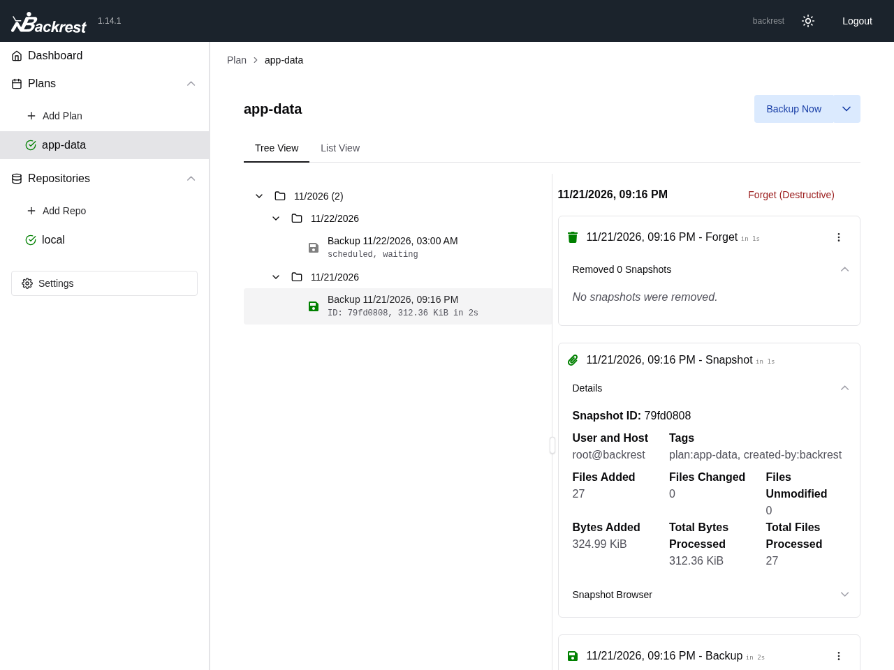
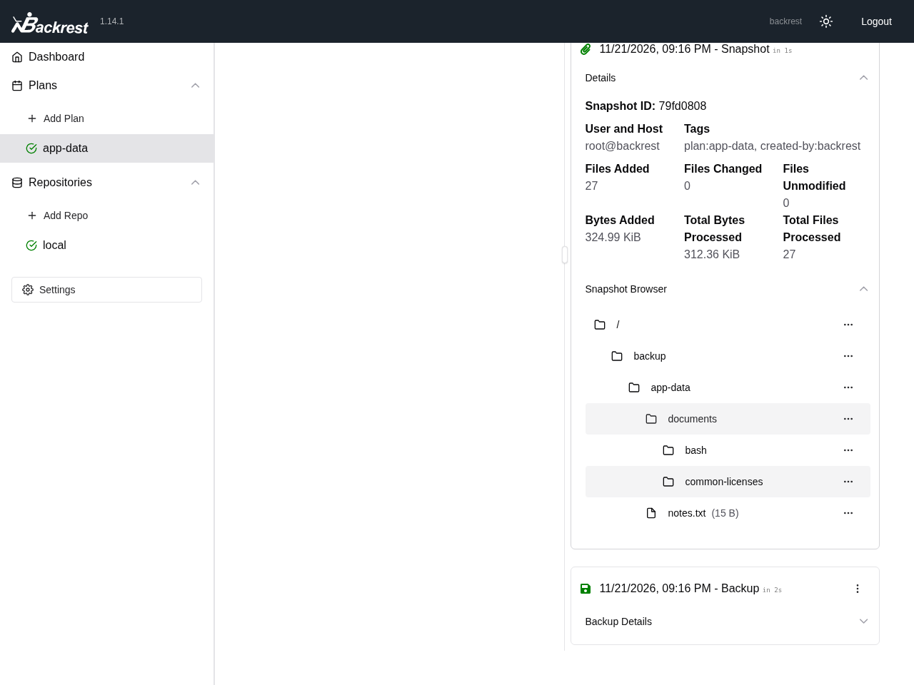

# Back up your LXD instances with Backrest

🇫🇷 [Lire en français](README.md)

Your LXD instances are running, their data lives in volumes… what about
backups? [restic](https://restic.net) is a great backup tool: deduplicated,
encrypted, able to write to a local disk, an SFTP server or S3 storage.
[Backrest](https://github.com/garethgeorge/backrest) adds a web UI on top of
it: scheduling, retention, history and snapshot browsing, restore in a few
clicks.

This tutorial sets up a dedicated **backup instance**. It reads the data of
another instance through a volume mounted **read-only**, and backs it up to a
restic repository stored on a separate volume. The application has nothing to
install, and the backup instance cannot damage what it backs up.




<sub>▶ [asciinema recording](install.cast)</sub>

## What you need

The same prerequisites as the [Docker tutorial](../docker/README.en.md#what-you-need):

- **LXD** installed and initialized (`lxc list` answers without error);
- **[mise](https://mise.jdx.dev)**, and this repository cloned and trusted
  (`mise trust`), see [Get the repository](../docker/README.en.md#1-get-the-repository);
- **internet access** from the instances (Ubuntu packages, GitHub to download
  Backrest and restic);
- a **browser** that reaches the instances (on the host, that is the case by
  default: the `lxdbr0` bridge is routed);
- room on a storage pool for the backup repository.

From here on, the data to protect is that of an `app` instance, in an
`app-data` volume mounted on `/srv/app`. Replace it with yours. To follow the
tutorial as is, create it:

```shell
lxc storage volume create default app-data size=5GiB
lxc launch ubuntu:lts app
lxc storage volume attach default app-data app /srv/app
lxc exec app -- sh -c 'echo "Hello from app" > /srv/app/notes.txt'
```

## 1. The `app-backrest` profile

```shell
mise run show app-backrest
```

The profile only holds cloud-init:

- a `backrest` systemd service, listening on port **9898** of the instance,
  with its configuration in `/etc/backrest/config.json` and its data in
  `/var/lib/backrest`;
- at first boot, the download of the latest Backrest release from GitHub, then
  the start of the service;
- Backrest downloads by itself the restic version it needs, and the profile
  makes it available on the command line (`/usr/local/bin/restic`) for
  restores and manual checks.

The service runs as `root` in the instance, to read every file of the mounted
volumes, whoever owns them. As the instance is unprivileged, that root has no
rights on the host.

```shell
mise run install app-backrest
```

## 2. The volumes

The restic repository has its own volume: it outlives the backup instance, and
can live on another pool, ideally another disk than the data.

```shell
lxc storage volume create default backups size=20GiB
```

`lxc storage volume list` shows the volumes and how many instances use them:

```shell
lxc storage volume list default type=custom --columns nu
```

## 3. The backup instance

```shell
lxc launch ubuntu:lts backrest --profile default --profile app-backrest
lxc config device add backrest backups disk pool=default source=backups path=/backups
lxc config device add backrest app-data disk pool=default source=app-data path=/backup/app-data readonly=true
```

- `backups` is mounted read/write on `/backups`: the restic repository will
  live there;
- `app-data` is mounted **read-only** (`readonly=true`) on `/backup/app-data`.
  A filesystem volume can be attached to several instances at once: `app`
  keeps writing to it, `backrest` reads it.

Devices are hot-plugged, no need to restart the instance. Wait for the end of
the installation, then check the service:

```shell
lxc exec backrest -- cloud-init status --wait --long
lxc exec backrest -- systemctl is-active backrest
lxc list backrest --columns ns4
```

The web UI answers on `http://<IPv4 address of the instance>:9898`.

> [!TIP]
> The read-only mounts of this repository follow this pattern:
> `volume-gitea-data-ro` and `volume-nextcloud-data-ro` mount the Gitea and
> Nextcloud data volumes under `/backup/`. For your own applications, one
> profile per backed up volume saves typing these commands. As for the
> `docker-volume-data` profile of the Docker tutorial, adapt the pool to your
> setup ([see how](../docker/README.en.md#adapt-an-installed-profile-to-your-needs)).

## 4. Configure Backrest

Everything happens in the web UI.

### First run

Backrest asks for an **instance ID** (it shows in the snapshots and cannot be
changed afterwards) and an administrator account. Disabling authentication is
possible, but not advised as soon as the UI is reachable from the network.



### The repository

**Add Repo**: a name (`local`), the repository URI (`/backups/restic`, on the
`backups` volume) and a password. **The password encrypts the repository:
without it, the backups cannot be read.** Keep a copy of it outside the
instance.

Backrest initializes the restic repository on submit. The next tabs schedule
the repository maintenance: `prune` (reclaim the space of forgotten snapshots)
and `check` (verify its integrity).



The URI can also point to remote storage (`s3:…`, `sftp:…`, `rclone:…`): the
best protection against losing the host disk.

### The backup plan

**Add Plan**: a name (`app-data`), the repository and the path(s) to back up
(`/backup/app-data`)…



… the schedule (here every day at 3am, cron expression `0 3 * * *`) and the
retention: how many snapshots to keep per hour, day, month…



### First backup

On the plan page, **Backup Now** runs a backup without waiting for the
schedule. The history shows every operation, the next scheduled backup and the
details of the snapshots:



The **Snapshot Browser** walks through the content of a snapshot. The `…` menu
of each file or directory restores it, or downloads it.



## 5. restic on the command line, and restoring a file


<sub>▶ [asciinema recording](restore.cast)</sub>

restic is available in the backup instance, next to Backrest. Backrest
snapshots are regular restic snapshots, tagged with the plan name:

```shell
lxc shell backrest
```

```shell
export RESTIC_REPOSITORY=/backups/restic RESTIC_PASSWORD=<repository password>
restic snapshots                                       # list of snapshots
restic ls latest /backup/app-data --recursive          # content of the latest
restic stats latest                                    # size
exit
```

To put a lost file back in the `app` instance, `restic dump` writes the file
taken from a snapshot to its standard output, and `lxc file push` drops it in
the instance:

```shell
lxc exec backrest --env RESTIC_PASSWORD=<repository password> -- \
  restic --repo /backups/restic dump latest /backup/app-data/notes.txt \
  | lxc file push --uid 0 --gid 0 --mode 0644 - app/srv/app/notes.txt
```

As the `app-data` volume is read-only for Backrest, it cannot restore in place.
To restore a whole directory, restore it into a directory of the backup
instance (from the UI: *Restore to path*, or
`restic restore latest --target /backups/restore`), then transfer it, or
attach the volume read/write for the time of the restore.

## Going further

- **Reach the UI from the network.** A `proxy` device publishes port 9898 on
  the host:

  ```shell
  lxc config device add backrest web proxy listen=tcp:0.0.0.0:9898 connect=tcp:127.0.0.1:9898
  ```
- **Protect the repository too.** The `backups` volume can have its own LXD
  snapshots (`snapshots.schedule`, see the
  [Docker tutorial](../docker/README.en.md#keep-docker-data-in-a-volume-with-automatic-snapshots)),
  and a second plan can back up the same data to a remote repository (S3,
  SFTP…).
- **Back up other instances.** One read-only device per volume, one plan per
  volume: a single backup instance is enough for a whole host.
- **Clean up.**

  ```shell
  lxc delete --force backrest app
  lxc storage volume delete default backups     # the backup repository!
  lxc storage volume delete default app-data
  lxc profile delete app-backrest
  ```

## Replaying the demos and screenshots

The animations of this page are recorded from the `install.yaml` and
`restore.yaml` scenarios (see [how the demos are made](../README.en.md)), the
UI screenshots with `screenshots.sh`: a Debian instance with Chromium, driven
by [Playwright](https://playwright.dev) (`screenshots.mjs`), fills in the
forms as described above.

```shell
MISE_ENV=demo mise run demo backrest/install
MISE_ENV=demo mise run demo backrest/restore
demo/backrest/screenshots.sh
```

They create the `backrest` and `app` instances, the `backups` and `app-data`
volumes and the `app-backrest` profile, then remove them at the end.
`restore.yaml` configures Backrest through its configuration file rather than
the UI. In the animation, the cloud-init wait is sped up.
