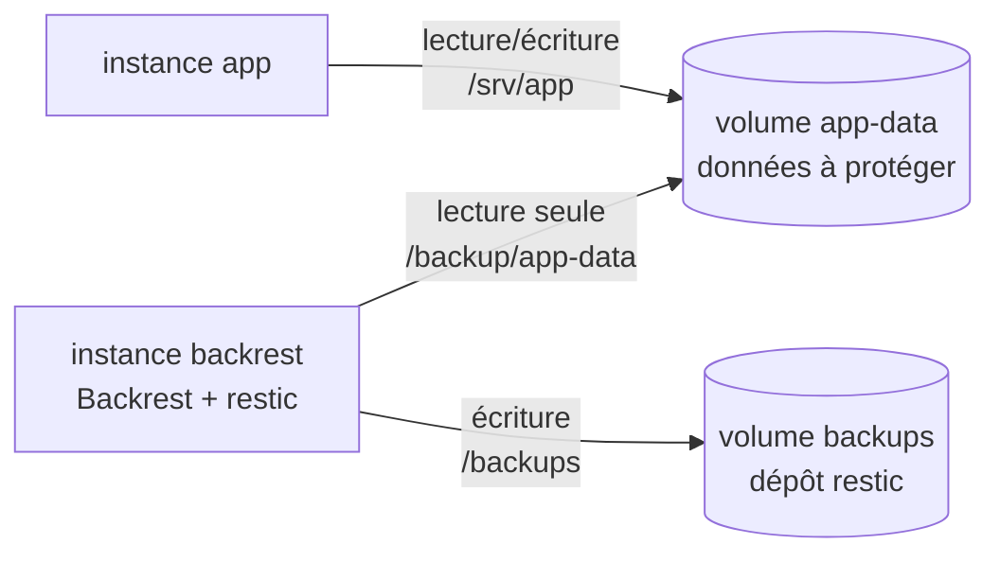
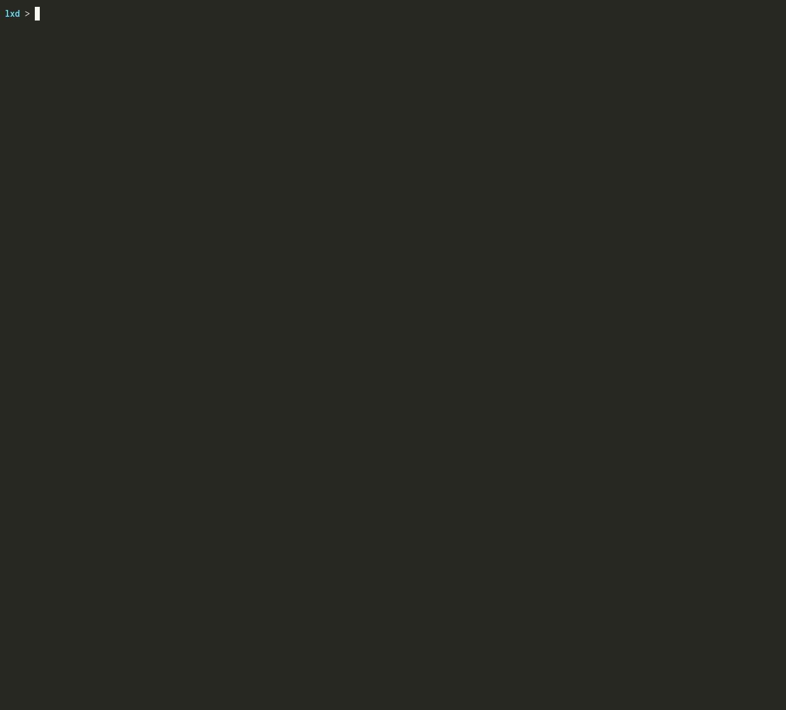
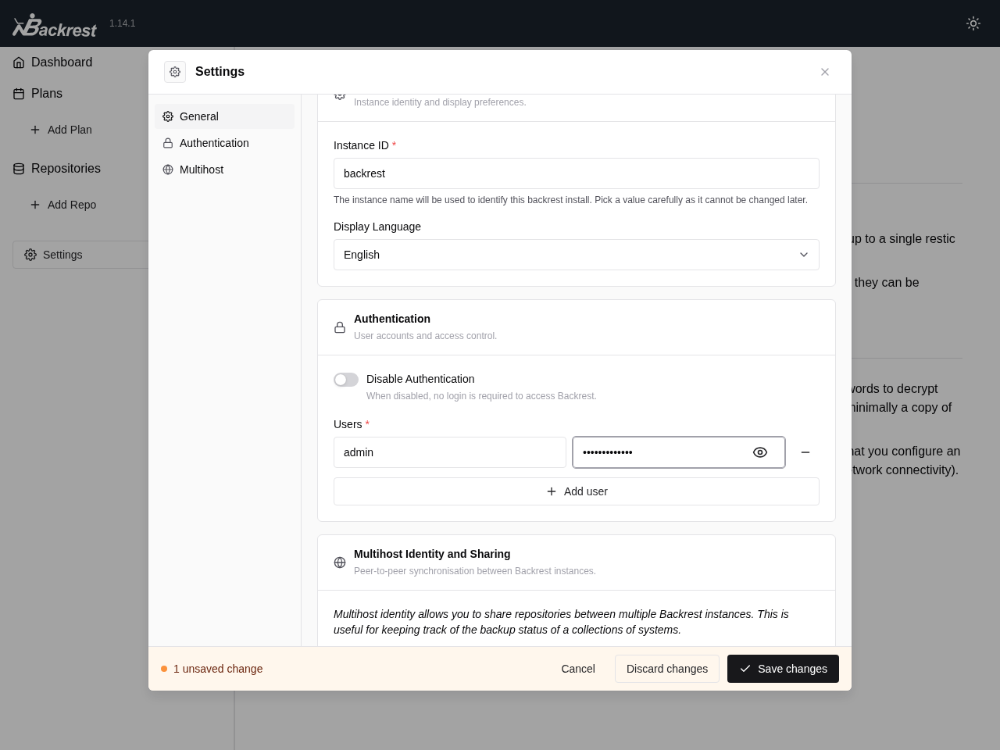
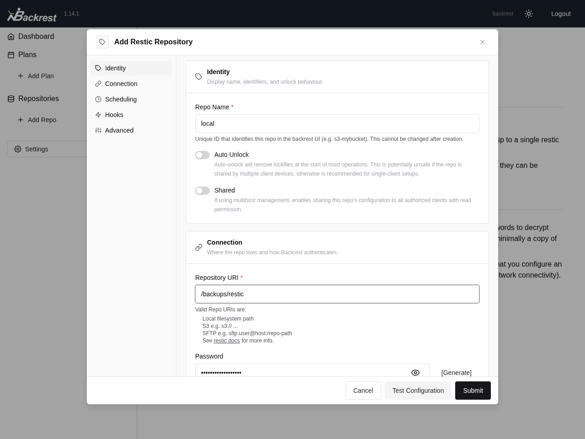
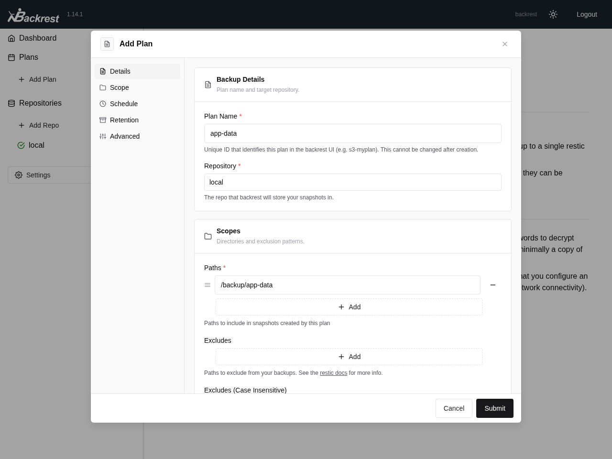
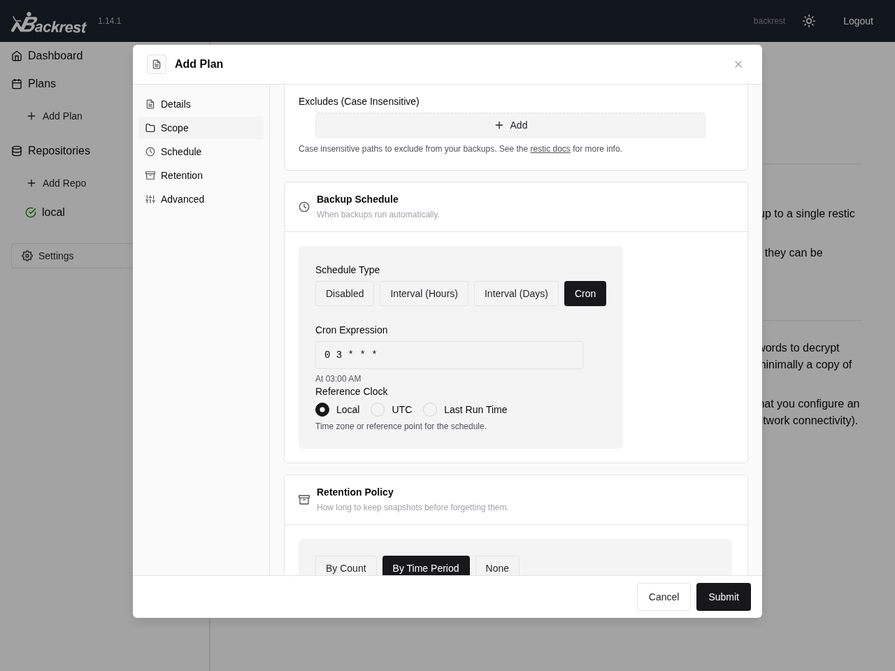
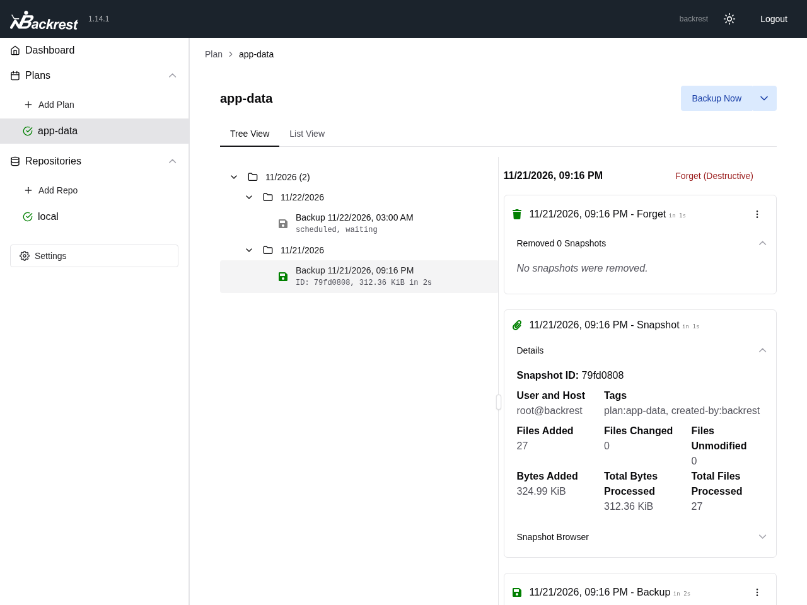
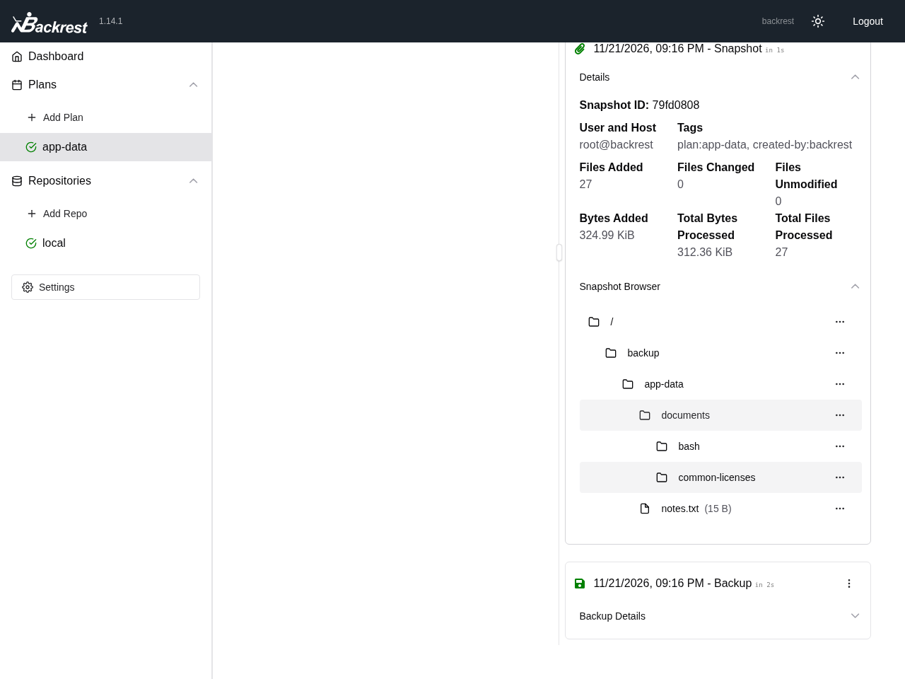
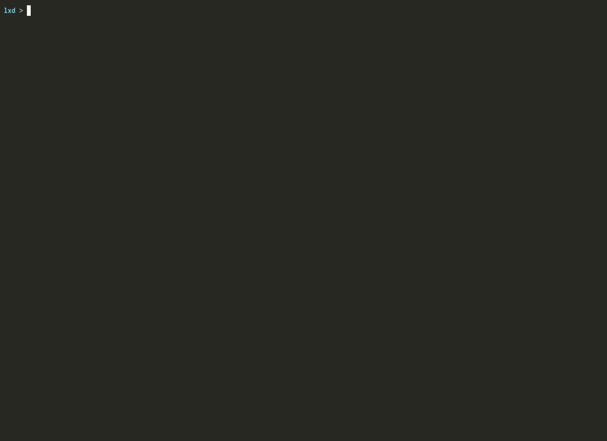

# Sauvegarder ses instances LXD avec Backrest

🇬🇧 [Read in English](README.en.md)

Vos instances LXD tournent, leurs données vivent dans des volumes… et les
sauvegardes ? [restic](https://restic.net) est un excellent outil de
sauvegarde : dédupliqué, chiffré, capable d'écrire sur un disque local, un
serveur SFTP ou un stockage S3. [Backrest](https://github.com/garethgeorge/backrest)
lui ajoute une interface web : planification, rétention, historique et
navigation dans les snapshots, restauration en quelques clics.

Ce tutoriel met en place une **instance de sauvegarde** dédiée. Elle lit les
données d'une autre instance à travers un volume monté **en lecture seule** et
les sauvegarde dans un dépôt restic posé sur un volume à part. L'application
n'a rien à installer, et l'instance de sauvegarde ne peut pas abîmer ce
qu'elle sauvegarde.





<sub>▶ [Enregistrement asciinema](install.cast)</sub>

## Ce qu'il vous faut

Les mêmes prérequis que pour le [tutoriel Docker](../docker/README.md#ce-quil-vous-faut) :

- **LXD** installé et initialisé (`lxc list` répond sans erreur) ;
- **[mise](https://mise.jdx.dev)** et ce dépôt cloné et approuvé
  (`mise trust`), voir [Récupérer le dépôt](../docker/README.md#1-récupérer-le-dépôt) ;
- un **accès à internet** depuis les instances (paquets Ubuntu, GitHub pour
  télécharger Backrest et restic) ;
- un **navigateur** qui atteint les instances (sur la machine hôte, c'est le
  cas par défaut : le bridge `lxdbr0` est routé) ;
- de la place sur un pool de stockage pour le dépôt de sauvegarde.

Dans la suite, les données à protéger sont celles d'une instance `app`, dans
un volume `app-data` monté sur `/srv/app`. Remplacez-les par les vôtres. Pour
suivre le tutoriel à l'identique, créez-les :

```shell
lxc storage volume create default app-data size=5GiB
lxc launch ubuntu:lts app
lxc storage volume attach default app-data app /srv/app
lxc exec app -- sh -c 'echo "Hello from app" > /srv/app/notes.txt'
```

## 1. Le profil `app-backrest`

```shell
mise run show app-backrest
```

Le profil ne contient que du cloud-init :

- un service systemd `backrest`, qui écoute sur le port **9898** de
  l'instance, garde sa configuration dans `/etc/backrest/config.json` et ses
  données dans `/var/lib/backrest` ;
- au premier démarrage, le téléchargement de la dernière version de Backrest
  depuis GitHub, puis le démarrage du service ;
- Backrest télécharge lui-même la version de restic dont il a besoin, et le
  profil la rend disponible en ligne de commande (`/usr/local/bin/restic`) pour
  les restaurations et les vérifications à la main.

Le service tourne en `root` dans l'instance, pour lire tous les fichiers des
volumes montés, quels que soient leurs propriétaires. Comme l'instance n'est
pas privilégiée, ce root n'a aucun droit sur l'hôte.

```shell
mise run install app-backrest
```

## 2. Les volumes

Le dépôt restic a son propre volume : il survit à l'instance de sauvegarde, et
on peut le placer sur un autre pool, idéalement un autre disque que les
données.

```shell
lxc storage volume create default backups size=20GiB
```

`lxc storage volume list` montre les volumes et le nombre d'instances qui les
utilisent :

```shell
lxc storage volume list default type=custom --columns nu
```

## 3. L'instance de sauvegarde

```shell
lxc launch ubuntu:lts backrest --profile default --profile app-backrest
lxc config device add backrest backups disk pool=default source=backups path=/backups
lxc config device add backrest app-data disk pool=default source=app-data path=/backup/app-data readonly=true
```

- `backups` est monté en lecture/écriture sur `/backups` : c'est là que vivra
  le dépôt restic ;
- `app-data` est monté **en lecture seule** (`readonly=true`) sur
  `/backup/app-data`. Un volume de type système de fichiers peut être attaché
  à plusieurs instances à la fois : `app` continue d'y écrire, `backrest` le
  lit.

Les devices s'ajoutent à chaud, pas besoin de redémarrer l'instance. On attend
la fin de l'installation, puis on vérifie le service :

```shell
lxc exec backrest -- cloud-init status --wait --long
lxc exec backrest -- systemctl is-active backrest
lxc list backrest --columns ns4
```

L'interface web répond sur `http://<adresse IPv4 de l'instance>:9898`.

> [!TIP]
> Les montages en lecture seule de ce dépôt suivent ce modèle :
> `volume-gitea-data-ro` et `volume-nextcloud-data-ro` montent les volumes de
> données de Gitea et Nextcloud sous `/backup/`. Pour vos propres
> applications, un profil par volume sauvegardé évite de retaper ces
> commandes. Comme pour le profil `docker-volume-data` du tutoriel Docker,
> adaptez le pool à votre installation
> ([voir comment](../docker/README.md#adapter-un-profil-installé-à-son-besoin)).

## 4. Configurer Backrest

Tout se passe dans l'interface web.

### Premier démarrage

Backrest demande un **identifiant d'instance** (il apparaît dans les snapshots
et ne se change plus ensuite) et un compte administrateur. Désactiver
l'authentification est possible, mais déconseillé dès que l'interface est
joignable depuis le réseau.



### Le dépôt

**Add Repo** : un nom (`local`), l'URI du dépôt (`/backups/restic`, sur le
volume `backups`) et un mot de passe. **Le mot de passe chiffre le dépôt : sans
lui, les sauvegardes sont illisibles.** Gardez-en une copie ailleurs que dans
l'instance.

Backrest initialise le dépôt restic à la validation. Les onglets suivants
programment la maintenance du dépôt : `prune` (récupérer la place des
snapshots oubliés) et `check` (vérifier son intégrité).



L'URI peut aussi désigner un stockage distant (`s3:…`, `sftp:…`, `rclone:…`) :
c'est la meilleure protection contre la perte du disque de l'hôte.

### Le plan de sauvegarde

**Add Plan** : un nom (`app-data`), le dépôt et le ou les chemins à
sauvegarder (`/backup/app-data`)…



… la planification (ici, tous les jours à 3 h, expression cron `0 3 * * *`) et
la rétention : combien de snapshots garder par heure, jour, mois…



### Première sauvegarde

Sur la page du plan, **Backup Now** lance une sauvegarde sans attendre la
planification. L'historique montre chaque opération, la prochaine sauvegarde
programmée et le détail des snapshots :



Le **Snapshot Browser** parcourt le contenu d'un snapshot. Le menu `…` de
chaque fichier ou dossier permet de le restaurer, ou de le télécharger.



## 5. restic en ligne de commande, et restaurer un fichier



<sub>▶ [Enregistrement asciinema](restore.cast)</sub>

restic est disponible dans l'instance de sauvegarde, à côté de Backrest. Les
snapshots de Backrest sont des snapshots restic ordinaires, étiquetés avec le
nom du plan :

```shell
lxc shell backrest
```

```shell
export RESTIC_REPOSITORY=/backups/restic RESTIC_PASSWORD=<mot de passe du dépôt>
restic snapshots                                       # liste des snapshots
restic ls latest /backup/app-data --recursive          # contenu du dernier
restic stats latest                                    # taille
exit
```

Pour remettre un fichier perdu en place dans l'instance `app`, `restic dump`
écrit le fichier tiré d'un snapshot sur sa sortie standard, et
`lxc file push` le dépose dans l'instance :

```shell
lxc exec backrest --env RESTIC_PASSWORD=<mot de passe du dépôt> -- \
  restic --repo /backups/restic dump latest /backup/app-data/notes.txt \
  | lxc file push --uid 0 --gid 0 --mode 0644 - app/srv/app/notes.txt
```

Comme le volume `app-data` est en lecture seule pour Backrest, il ne peut pas
restaurer directement à sa place. Pour restaurer un dossier entier, on
restaure dans un dossier de l'instance de sauvegarde (depuis l'interface :
*Restore to path*, ou `restic restore latest --target /backups/restore`), puis
on le transfère, ou on attache le volume en écriture le temps de la
restauration.

## Pour aller plus loin

- **Accéder à l'interface depuis le réseau.** Un device `proxy` publie le port
  9898 sur l'hôte :

  ```shell
  lxc config device add backrest web proxy listen=tcp:0.0.0.0:9898 connect=tcp:127.0.0.1:9898
  ```
- **Protéger aussi le dépôt.** Le volume `backups` peut avoir ses propres
  snapshots LXD (`snapshots.schedule`, voir le
  [tutoriel Docker](../docker/README.md#garder-les-données-docker-dans-un-volume-avec-des-snapshots-automatiques)),
  et un second plan peut sauvegarder les mêmes données vers un dépôt distant
  (S3, SFTP…).
- **Sauvegarder d'autres instances.** Un device en lecture seule par volume,
  un plan par volume : une seule instance de sauvegarde suffit pour tout un
  hôte.
- **Faire le ménage.**

  ```shell
  lxc delete --force backrest app
  lxc storage volume delete default backups     # le dépôt de sauvegarde !
  lxc storage volume delete default app-data
  lxc profile delete app-backrest
  ```

## Rejouer les démos et les captures

Les animations de cette page sont enregistrées à partir des scénarios
`install.yaml` et `restore.yaml` (voir [comment sont produites les démos](../README.md)),
les captures de l'interface avec `screenshots.sh` : une instance Debian avec
Chromium, pilotée par [Playwright](https://playwright.dev) (`screenshots.mjs`),
remplit les formulaires comme décrit plus haut.

```shell
MISE_ENV=demo mise run demo backrest/install
MISE_ENV=demo mise run demo backrest/restore
demo/backrest/screenshots.sh
```

Ils créent les instances `backrest` et `app`, les volumes `backups` et
`app-data` et le profil `app-backrest`, puis les suppriment à la fin.
`restore.yaml` configure Backrest par son fichier de configuration plutôt que
par l'interface. Dans l'animation, l'attente de cloud-init est accélérée.
