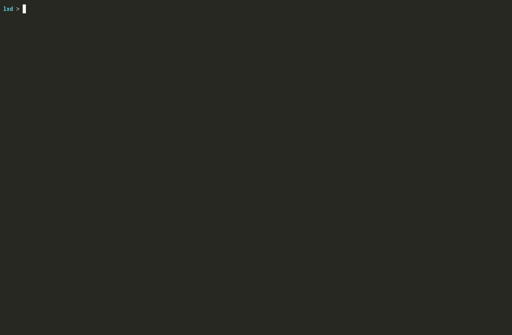

# Docker in an LXD container, in a few minutes

🇫🇷 [Lire en français](README.md)

Need a throwaway Docker to try an image, isolate a project or run a few
services without touching your machine? An LXD system container does the job
nicely: it starts in seconds, behaves like a small, complete Ubuntu machine,
and goes away with a single command.

This tutorial starts from scratch: get this repository, install the
`docker-unprivileged` profile in LXD, launch an instance that installs Docker
by itself at first boot, then use it.



<sub>▶ [asciinema recording](install.cast)</sub>

## What you need

- **LXD**, installed and initialized, with a user allowed to use it (member of
  the `lxd` group):

  ```shell
  sudo snap install lxd
  sudo usermod --append --groups lxd "$USER"   # then log in again
  sudo lxd init --auto                         # default storage pool and lxdbr0 bridge
  ```

  `lxc list` must answer without error. The tutorial also works with nested
  LXD (LXD itself running in an LXD container): that is how the demos were
  recorded.
- **[mise](https://mise.jdx.dev)**, which provides the repository tasks
  (`list`, `show`, `install`…) and installs the small tools they use (`bat`,
  `delta`, `gum`, `yq`):

  ```shell
  curl https://mise.run | sh
  echo 'eval "$(~/.local/bin/mise activate bash)"' >> ~/.bashrc   # then reopen the shell
  ```

  mise is optional: the [Without mise](#without-mise) section gives the
  equivalent with plain `lxc`.
- **git**, and **internet access** from the instances (Ubuntu packages, the
  `get.docker.com` script, Docker Hub).
- About **2 GB of free disk** on the LXD storage pool.

## 1. Get the repository

```shell
git clone https://gitea.cloud.logerais.com/xavier/lxd-profiles.git
mise trust lxd-profiles
cd lxd-profiles
mise install    # tools used by the tasks (bat, delta, gum, yq), once
```

`mise trust` allows mise to load the repository configuration (`mise.toml`):
for safety, mise ignores configuration files it has not been explicitly told
to trust. Entering the directory displays a welcome message listing the
available tasks.

## 2. Choose and install the profile

Let's first see what the repository offers around Docker, and what is already
installed in LXD:

```shell
mise run list | grep --extended-regexp 'PROFIL|docker'
```

```
     PROFIL                   DESCRIPTION                                        UTILISÉ FICHIER
  ⬜ docker                   A profile that deploy docker in an LXD container   -       profiles/containerization/docker.profile.yaml
  ⬜ docker-unprivileged      A profile that deploy docker in an unprivileged L… -       profiles/containerization/docker-unprivileged.profile.yaml
  ...
```

⬜ means "in the repository, not installed in LXD yet". Two profiles install
Docker:

- `docker` creates a **privileged** container: root in the container is root
  on the host. It is the most permissive one, for the cases that require it.
- `docker-unprivileged` keeps the container **unprivileged** (root in the
  container is an unprivileged user on the host). That is the one used here,
  and it is enough for the vast majority of images.

Let's look at its content:

```shell
mise run show docker-unprivileged
```

```yaml
name: docker-unprivileged
description: "A profile that deploy docker in an unprivileged LXD container"
config:
  linux.kernel_modules: overlay
  security.nesting: "true"
  # Requis pour les images dont les couches créent des device nodes ou des xattrs
  security.syscalls.intercept.mknod: "true"
  security.syscalls.intercept.setxattr: "true"
  cloud-init.vendor-data: |
    #cloud-config
    package_update: true
    package_upgrade: true
    packages:
      - curl
    runcmd:
      - curl https://get.docker.com | sh
    timezone: Europe/Paris
    locale: fr_FR.UTF-8
```

Nothing magic:

- `security.nesting` allows containers inside the container: Docker needs it
  to create its own.
- `linux.kernel_modules: overlay` loads on the host the module of the
  filesystem Docker uses for its images.
- the two `security.syscalls.intercept.*` let LXD handle, on behalf of the
  container, the system calls some images make when their layers are
  extracted, which an unprivileged container is not allowed to make.
- `cloud-init.vendor-data` is the first boot recipe: system update, then
  Docker installation with the official script.

Install it in LXD:

```shell
mise run install docker-unprivileged
mise run list | grep --extended-regexp 'PROFIL|docker-unprivileged'   # ✅: up to date in LXD
```

## 3. Launch the instance and follow its installation

`ubuntu:lts` is the latest Ubuntu LTS release (26.04 at the time of writing).
A profile is added at launch, after the `default` profile (which brings the
disk and the network):

```shell
lxc launch ubuntu:lts docker --profile default --profile docker-unprivileged
```

The instance starts in seconds, but cloud-init is still working in the
background: package upgrade, then Docker installation, about a minute. To wait
for the end and get the summary, errors included (`errors: []` when all went
well):

```shell
lxc exec docker -- cloud-init status --wait --long
```

To follow the installation live instead, the cloud-init log reads like any
file (Ctrl+C to stop):

```shell
lxc exec docker -- tail --follow /var/log/cloud-init-output.log
```

Once done, Docker is there:

```shell
lxc exec docker -- docker version --format 'Docker {{.Server.Version}}'
lxc list docker
```

The instance has two IPv4 addresses: its `eth0` interface on the LXD bridge,
and the `docker0` bridge Docker just created inside.

## 4. Use Docker


<sub>▶ [asciinema recording](usage.cast)</sub>

### From the host, with `lxc exec`

`lxc exec <instance> -- <command>` runs a command in the instance, without SSH
nor any setup. The classic:

```shell
lxc exec docker -- docker run --rm hello-world
```

### From a shell in the instance

For a real working session, `lxc shell` opens a root shell in the instance,
and Docker is used as on any machine:

```shell
lxc shell docker
```

```shell
docker run --detach --name web --publish 8080:80 nginx:alpine   # a web server in the background
docker image ls                                                 # downloaded images
docker ps                                                       # running containers
docker top web --format pid,user,args                           # processes of the web container
docker stats --no-stream                                        # CPU, memory, network
curl --silent localhost:8080 | grep title                       # nginx answers
exit                                                            # back to the host
```

## Going further

### Reach the service from the host

Port 8080 is published by Docker inside the instance. An LXD `proxy` device
makes it reachable on the host (and so from your network):

```shell
lxc config device add docker web proxy listen=tcp:0.0.0.0:8080 connect=tcp:127.0.0.1:8080
curl --silent localhost:8080 | grep title
```

If port 8080 is already taken on the host, change the `listen` one. The
repository also has ready-made profiles for that (`proxy-http`,
`proxy-https`).

### Keep Docker data in a volume, with automatic snapshots

By default, Docker images, containers and volumes live in `/var/lib/docker`,
on the instance disk: they go away with it. The `docker-volume-data` profile
mounts a dedicated LXD volume there instead, with a life of its own: it
survives the instance deletion, attaches to a new one, and is backed up
separately.

The volume must exist **before** the profile is installed, LXD checks it.
Create it on the `default` pool, the one the profile expects, and schedule
snapshots for it: one a day, kept for two weeks.

```shell
lxc storage volume create default docker-data size=20GiB
lxc storage volume set default docker-data snapshots.schedule=@daily snapshots.expiry=2w
mise run install docker-volume-data
```

Add the profile **when the instance is created**, so that Docker installs
directly on the volume:

```shell
lxc launch ubuntu:lts docker --profile default --profile docker-unprivileged --profile docker-volume-data
lxc exec docker -- findmnt --target /var/lib/docker   # the volume is mounted
```

Volume snapshots are handled with `lxc storage volume`:

```shell
lxc storage volume snapshot default docker-data before-upgrade   # manual snapshot
lxc storage volume info default docker-data                      # list of snapshots
lxc stop docker                                                  # instance stopped to restore
lxc storage volume restore default docker-data before-upgrade
lxc start docker
```

The `snapshots-daily` profile is not enough here: it schedules snapshots of
the **instance**, which do not include attached volumes. These are two
separate settings, and both can be combined.

### Adapt an installed profile to your needs

The repository profiles are a starting point. Say you want Docker data on
another, faster pool named `fast`. Copy the volume (with its snapshots and
their schedule), then change the profile installed in LXD directly:

```shell
lxc stop docker
lxc storage volume copy default/docker-data fast/docker-data
lxc profile device set docker-volume-data docker-data pool=fast
lxc start docker
lxc storage volume delete default docker-data   # once checked
```

The volume is **copied** rather than moved: LXD refuses to move a volume a
profile refers to. The change applies to every instance using the profile.

The installed profile no longer matches the repository, and the mise tasks
say so:

```shell
mise run list | grep docker-volume-data   # 📝: installed but different
mise run diff docker-volume-data
```

```diff
--- lxd:docker-volume-data (installé)
+++ profiles/containerization/docker-volume-data.profile.yaml (dépôt)
@@ -3,7 +3,7 @@
 devices:
   docker-data:
     path: /var/lib/docker
-    pool: fast
+    pool: default
     source: docker-data
     type: disk
```

Two options then:

- **back to the repository version**: `mise run install docker-volume-data`
  shows this diff and asks for confirmation before overwriting the profile;
- **keep your version**: `mise run import docker-volume-data` rewrites the
  repository file from the installed profile. Review it with `git diff`, then
  commit it in your clone (or your fork).

LXD lets several instances attach the same volume, but two Docker daemons must
never share the same `/var/lib/docker`. For a second Docker instance, copy the
profile and give it its own volume:

```shell
lxc storage volume create default docker2-data
lxc profile copy docker-volume-data docker2-volume-data
lxc profile device set docker2-volume-data docker-data source=docker2-data
```

### Combine profiles

Profiles stack at launch: instance size (`size-small`, `size-medium`…),
automatic instance snapshots (`snapshots-daily`), data volume
(`docker-volume-data`)…

```shell
lxc launch ubuntu:lts docker --profile default --profile docker-unprivileged \
  --profile docker-volume-data --profile size-medium --profile snapshots-daily
```

### Clean up

The instance goes away with one command, Docker with it. The data volume
stays: delete it explicitly if no longer needed, like the profiles.

```shell
lxc delete --force docker
lxc storage volume delete default docker-data
lxc profile delete docker-volume-data
lxc profile delete docker-unprivileged
```

## Without mise

The repository files are regular LXD profiles: `lxc` is enough.

```shell
lxc profile create docker-unprivileged
lxc profile edit docker-unprivileged < profiles/containerization/docker-unprivileged.profile.yaml
lxc launch ubuntu:lts docker --profile default --profile docker-unprivileged
```

## Replaying the demos

The animations of this page are recorded from the `install.yaml` and
`usage.yaml` scenarios (see [how the demos are made](../README.en.md)):

```shell
MISE_ENV=demo mise run demo docker/install
MISE_ENV=demo mise run demo docker/usage
```

They create the `docker` instance and the `docker-unprivileged` profile, and
remove them at the end; `install` refuses to start if they already exist. In
the animation, the cloud-init wait is sped up.
