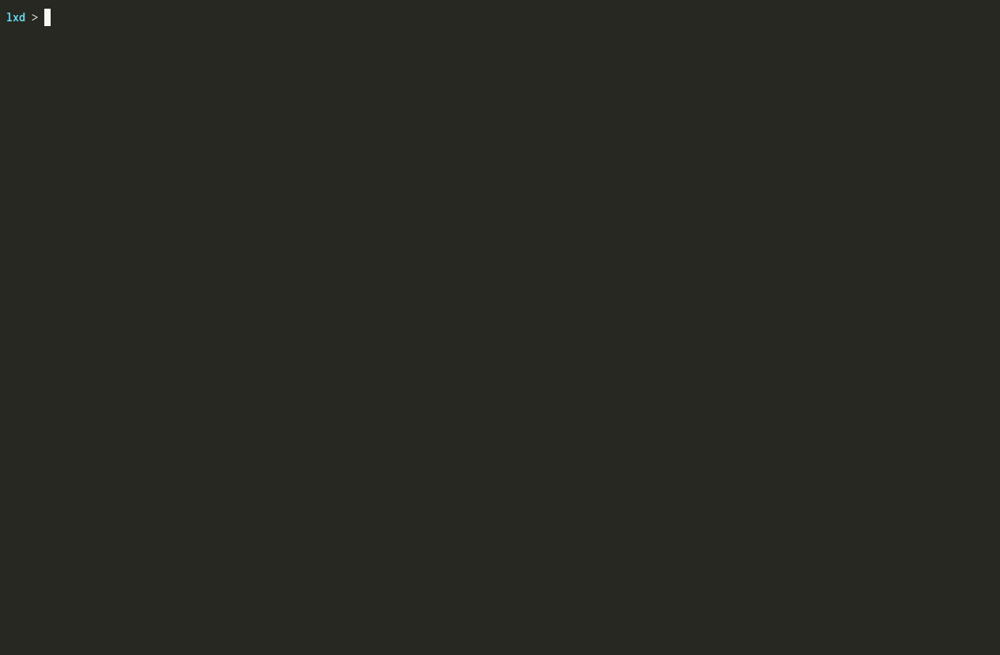

# Docker dans un conteneur LXD, en quelques minutes

🇬🇧 [Read in English](README.en.md)

Vous voulez un Docker jetable pour tester une image, isoler un projet ou faire
tourner quelques services sans toucher à votre machine ? Un conteneur système
LXD fait très bien l'affaire : il démarre en quelques secondes, se comporte
comme une petite machine Ubuntu complète, et se supprime d'une commande.

Ce tutoriel part de zéro : on récupère ce dépôt, on installe le profil
`docker-unprivileged` dans LXD, on lance une instance qui installe Docker toute
seule au premier démarrage, puis on s'en sert.


<sub>▶ [Enregistrement asciinema](install.cast) (pause, avance rapide)</sub>

## Ce qu'il vous faut

- **LXD**, installé et initialisé, avec un utilisateur qui a le droit de
  l'utiliser (membre du groupe `lxd`) :

  ```shell
  sudo snap install lxd
  sudo usermod --append --groups lxd "$USER"   # puis se reconnecter
  sudo lxd init --auto                         # pool de stockage et bridge lxdbr0 par défaut
  ```

  `lxc list` doit répondre sans erreur. Le tutoriel fonctionne aussi dans un
  LXD imbriqué (LXD lui-même dans un conteneur LXD), c'est d'ailleurs dans ces
  conditions qu'ont été enregistrées les démos.
- **[mise](https://mise.jdx.dev)**, qui fournit les tâches du dépôt (`list`,
  `show`, `install`…) et installe les petits outils qu'elles utilisent (`bat`,
  `delta`, `gum`, `yq`) :

  ```shell
  curl https://mise.run | sh
  echo 'eval "$(~/.local/bin/mise activate bash)"' >> ~/.bashrc   # puis rouvrir le shell
  ```

  mise reste optionnel : la section [Sans mise](#sans-mise) donne l'équivalent
  avec `lxc` seul.
- **git**, et un **accès à internet** depuis les instances (paquets Ubuntu,
  script `get.docker.com`, Docker Hub).
- Environ **2 Go de disque** libres sur le pool de stockage LXD.

## 1. Récupérer le dépôt

```shell
git clone https://gitea.cloud.logerais.com/xavier/lxd-profiles.git
mise trust lxd-profiles
cd lxd-profiles
mise install    # outils des tâches (bat, delta, gum, yq), une seule fois
```

`mise trust` autorise mise à charger la configuration du dépôt (`mise.toml`) :
par sécurité, mise ignore les fichiers de configuration qu'on ne lui a pas
explicitement désignés comme fiables. En entrant dans le dossier, un message
d'accueil rappelle les tâches disponibles.

## 2. Choisir et installer le profil

Commençons par voir ce que le dépôt propose autour de Docker, et ce qui est déjà
installé dans LXD :

```shell
mise run list | grep --extended-regexp 'PROFIL|docker'
```

```
     PROFIL                   DESCRIPTION                                        UTILISÉ FICHIER
  ⬜ docker                   A profile that deploy docker in an LXD container   -       profiles/containerization/docker.profile.yaml
  ⬜ docker-unprivileged      A profile that deploy docker in an unprivileged L… -       profiles/containerization/docker-unprivileged.profile.yaml
  ...
```

⬜ signifie « présent dans le dépôt, pas encore installé dans LXD ». Deux profils
installent Docker :

- `docker` crée un conteneur **privilégié** : root dans le conteneur est root
  sur l'hôte. C'est le plus permissif, à réserver aux cas qui l'exigent.
- `docker-unprivileged` garde le conteneur **non privilégié** (root dans le
  conteneur est un utilisateur sans droits sur l'hôte). C'est celui qu'on
  utilise ici, et il suffit pour l'immense majorité des images.

Regardons ce qu'il contient :

```shell
mise run show docker-unprivileged
```

```yaml
name: docker-unprivileged
description: "A profile that deploy docker in an unprivileged LXD container"
config:
  linux.kernel_modules: overlay
  security.nesting: "true"
  # Requis pour les images dont les couches créent des device nodes ou des xattrs
  security.syscalls.intercept.mknod: "true"
  security.syscalls.intercept.setxattr: "true"
  cloud-init.vendor-data: |
    #cloud-config
    package_update: true
    package_upgrade: true
    packages:
      - curl
    runcmd:
      - curl https://get.docker.com | sh
    timezone: Europe/Paris
    locale: fr_FR.UTF-8
```

Rien de magique :

- `security.nesting` autorise les conteneurs dans le conteneur : c'est ce dont
  Docker a besoin pour créer les siens.
- `linux.kernel_modules: overlay` charge sur l'hôte le module du système de
  fichiers utilisé par Docker pour ses images.
- les deux `security.syscalls.intercept.*` laissent LXD traiter, à la place du
  conteneur, les appels système que certaines images utilisent à l'extraction
  de leurs couches et qu'un conteneur non privilégié n'a pas le droit de faire.
- `cloud-init.vendor-data` est la recette du premier démarrage : mise à jour
  du système, puis installation de Docker avec le script officiel.

On l'installe dans LXD :

```shell
mise run install docker-unprivileged
mise run list | grep --extended-regexp 'PROFIL|docker-unprivileged'   # ✅ : à jour dans LXD
```

## 3. Lancer l'instance et suivre son installation

`ubuntu:lts` désigne la dernière version LTS d'Ubuntu (26.04 à l'écriture de ces
lignes). Un profil s'ajoute au lancement, après le profil `default` (qui
apporte le disque et le réseau) :

```shell
lxc launch ubuntu:lts docker --profile default --profile docker-unprivileged
```

L'instance démarre en quelques secondes, mais cloud-init travaille encore en
arrière-plan : mise à jour des paquets puis installation de Docker, environ une
minute. Pour attendre la fin et obtenir le bilan, erreurs éventuelles comprises
(`errors: []` quand tout s'est bien passé) :

```shell
lxc exec docker -- cloud-init status --wait --long
```

Pour suivre plutôt l'installation en direct, le journal de cloud-init se lit
comme n'importe quel fichier (Ctrl+C pour arrêter) :

```shell
lxc exec docker -- tail --follow /var/log/cloud-init-output.log
```

Une fois terminé, Docker est là :

```shell
lxc exec docker -- docker version --format 'Docker {{.Server.Version}}'
lxc list docker
```

L'instance a deux adresses IPv4 : celle de son interface `eth0` sur le bridge
LXD, et celle du bridge `docker0` que Docker vient de créer à l'intérieur.

## 4. Utiliser Docker


<sub>▶ [Enregistrement asciinema](usage.cast) (pause, avance rapide)</sub>

### Depuis l'hôte, avec `lxc exec`

`lxc exec <instance> -- <commande>` exécute une commande dans l'instance, sans
SSH ni configuration. Le grand classique :

```shell
lxc exec docker -- docker run --rm hello-world
```

### Depuis un shell dans l'instance

Pour une vraie session de travail, `lxc shell` ouvre un shell root dans
l'instance, et Docker s'utilise comme sur n'importe quelle machine :

```shell
lxc shell docker
```

```shell
docker run --detach --name web --publish 8080:80 nginx:alpine   # un serveur web en arrière-plan
docker image ls                                                 # images téléchargées
docker ps                                                       # conteneurs en cours
docker top web --format pid,user,args                           # processus du conteneur web
docker stats --no-stream                                        # CPU, mémoire, réseau
curl --silent localhost:8080 | grep title                       # nginx répond
exit                                                            # retour sur l'hôte
```

## Pour aller plus loin

- **Accéder au service depuis l'hôte.** Le port 8080 publié par Docker l'est
  dans l'instance. Un device `proxy` LXD le rend joignable sur l'hôte (et donc
  depuis votre réseau) :

  ```shell
  lxc config device add docker web proxy listen=tcp:0.0.0.0:8080 connect=tcp:127.0.0.1:8080
  curl --silent localhost:8080 | grep title
  ```

  Si le port 8080 est déjà pris sur l'hôte, changez celui de `listen`. Le dépôt
  propose aussi des profils prêts à l'emploi pour ça (`proxy-http`,
  `proxy-https`).
- **Combiner les profils.** Les profils s'empilent au lancement : taille de
  l'instance (`size-small`, `size-medium`…), snapshots automatiques
  (`snapshots-daily`), volume dédié aux données Docker (`docker-volume-data`)…

  ```shell
  lxc launch ubuntu:lts docker --profile default --profile docker-unprivileged \
    --profile size-medium --profile snapshots-daily
  ```
- **Faire le ménage.** L'instance se supprime d'une commande, Docker et ses
  images avec ; le profil, s'il ne sert plus :

  ```shell
  lxc delete --force docker
  lxc profile delete docker-unprivileged
  ```

## Sans mise

Les fichiers du dépôt sont des profils LXD ordinaires : `lxc` suffit.

```shell
lxc profile create docker-unprivileged
lxc profile edit docker-unprivileged < profiles/containerization/docker-unprivileged.profile.yaml
lxc launch ubuntu:lts docker --profile default --profile docker-unprivileged
```

## Rejouer les démos

Les animations de cette page sont enregistrées à partir des scénarios
`install.yaml` et `usage.yaml` (voir [comment sont produites les démos](../README.md)) :

```shell
MISE_ENV=demo mise run demo docker/install
MISE_ENV=demo mise run demo docker/usage
```

Ils créent l'instance `docker` et le profil `docker-unprivileged`, puis les
suppriment à la fin ; `install` refuse de démarrer s'ils existent déjà.
Dans l'animation, l'attente de cloud-init est accélérée.
